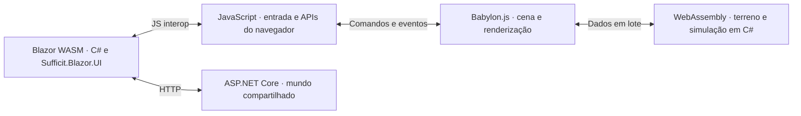

# Arquitetura do Ultima

O cliente usa Blazor WebAssembly no .NET 10. C# executa na máquina do jogador e
já responde pela interface, pelas regras, pelos modelos, pelo terreno e pela
simulação de movimento do jogador. Babylon.js desenha a cena, consulta as
malhas e controla a câmera. O backend ASP.NET Core é opcional para iniciar o jogo e atua
como autoridade do mundo compartilhado quando conectado.

## Responsabilidades atuais

| Camada | Responsabilidade |
| --- | --- |
| [Cliente Blazor](src/Ultima.csproj) | Estado dos controles, menus, janelas e ações de interface. Os componentes vêm da Sufficit.Blazor.UI, com o tema do jogo descrito em [DESIGN.md](DESIGN.md). |
| [Regras](src/Rules) e [NPCs](src/Npc) | Regras de interação e diálogo, agendamento de NPCs e eventos de animação. São código do jogo executado em C#. |
| [Serviços do navegador](src/Browser) | Mochila, Oficina, diário de diálogos, atualizações e sessão do mundo compartilhado. C# coordena os fluxos. Adaptadores JavaScript acessam APIs como IndexedDB e localStorage. |
| [Ponte de entrada e cena](src/wwwroot/js/game.js) | Captura entrada do navegador e encaminha comandos. [GAME.JsInterop.cs](src/GAME.JsInterop.cs) recebe eventos do motor para o Blazor. [game-core.js](src/wwwroot/js/game-core.js) mantém a cena, aplica as poses e resolve os raios de câmera, apoio e seleção. |
| [Terreno em C#](engine/Ultima.Terrain) | Calcula altura, superfície, malhas e escavação volumétrica. [BrowserExports.cs](engine/Ultima.Terrain/BrowserExports.cs) expõe operações que entregam dados de geometria em lote para a cena. |
| [Simulação em C#](engine/Ultima.Terrain/PlayerMovement.cs) | Normaliza o analógico, resolve aceleração, colisão, deslizamento e passagem por volumes. [PlayerPose](engine/Ultima.Terrain/PlayerPose.cs) calcula marcha, expressão, apoio dos pés e alcance de coleta. |
| [Modelos em C#](models) | Pacotes de personagens, árvores, rochas e cenário. O [carregador](src/Models/ModelLoader.cs) confere SHA-256 antes de carregar cada pacote e usa marcadores quando o pacote é recusado. |
| [Servidor](app/UltimaServer.csproj) | Sessões, eventos, validação de comandos e edições, mapa compartilhado e catálogo de assets. A API atual está em `app/`. O diretório [app-python](app-python) guarda a implementação anterior. |

## Modos de execução e persistência

- **Worker.** Quando o navegador oferece suporte, `game-worker.js` executa a
  cena com `OffscreenCanvas` e inicializa o módulo .NET de terreno. O Blazor e
  os eventos do DOM ficam na thread principal.
  [Inicialização do worker](src/wwwroot/js/game-worker.js)
- **Thread principal.** `?render=main` permite exercitar o fallback. A cena roda
  na thread principal e usa o código de terreno compartilhado com o projeto
  Blazor. Mudanças de terreno, movimento e interação precisam preservar o
  comportamento nos dois modos.
  [Inicialização do cliente](src/wwwroot/js/game.js) · [Projeto Blazor](src/Ultima.csproj)
- **Mundo compartilhado.** O cliente busca o mapa em `/v1/game/map` e envia
  comandos a `/v1/game/command`. O servidor valida ações e persiste as edições
  com log e snapshot. A implantação monta o volume `world-data` em `/data`.
  `?live=0` desativa a conexão com o mundo compartilhado. A mochila fica
  armazenada no navegador.
  [Uso do mundo](docs/USAGE-MUNDO.md) · [Persistência](app/WorldStore.cs) ·
  [Deployment do backend](docs/activities/202611232303-publicacao-do-backend-no-run.md)

## Simulação e interoperabilidade

O Babylon.js envia ao C# centros, raios e limites de altura dos colisores quando
muda o conjunto de obstáculos ativos. A cada quadro, o C# devolve posição,
orientação desejada e distância percorrida. O motor consulta a malha visível
para descobrir onde cada pé pousa e aplica as rotações devolvidas pelo C#.
A prévia e o clique de coleta consultam o mesmo alvo e o mesmo limite de alcance.
[Exportações da simulação](engine/Ultima.Terrain/BrowserExports.Player.cs)

Em extrações futuras, mantenha a consulta às malhas, a apresentação da cena e o
acesso às APIs do navegador nos adaptadores correspondentes. Câmera e
transições de ações são pontos para extrair cálculos determinísticos. O
Babylon.js aplica os resultados, assim como já faz com poses e marcas de
animação. Declare unidades, coordenadas e formatos nos contratos da ponte.
[Contrato de animações](docs/USAGE-ANIMACOES.md)

Compare o comportamento em worker e main e meça o custo da ponte, o tempo de
frame e as alocações. Agrupe os resultados que cruzam a ponte e preserve a
leitura de mapas e dados persistidos. Cubra as regras com
[RulesSmoke](tests/RulesSmoke) e exercite câmera, colisão, coleta e terreno pelos
[testes no navegador](tests).

## Publicação

O GitHub Pages publica o cliente estático a partir de `main`. O workflow
compila os pacotes de modelos e o terreno, prepara o catálogo de assets e
publica o Blazor WebAssembly. O backend tem implantação própria no Sufficit
Run. Verifique `build.json` do cliente para confirmar o SHA servido e `/health`
da API após uma implantação do backend.
[Workflow do cliente](.github/workflows/pages.yml) · [Configuração do Run](app.json)
