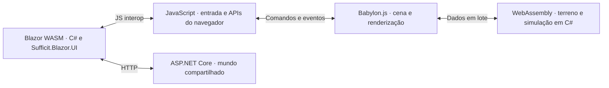

# Arquitetura do Ultima

O cliente usa Blazor WebAssembly no .NET 10. C# executa na máquina do jogador e
já responde pela interface, pelas regras, pelos modelos, pelo terreno e pela
simulação de movimento do jogador. Babylon.js desenha a cena, consulta as
malhas e aplica a posição da câmera calculada pelo C#. O backend ASP.NET Core é opcional para iniciar o jogo e atua
como autoridade do mundo compartilhado quando conectado.



## Responsabilidades atuais

| Camada | Responsabilidade |
| --- | --- |
| [Cliente Blazor](src/Ultima.csproj) | Estado dos controles, menus, janelas e ações de interface. Os componentes vêm da Sufficit.Blazor.UI, com o tema do jogo descrito em [DESIGN.md](DESIGN.md). |
| [Regras](src/Rules) e [NPCs](src/Npc) | Regras de interação e diálogo, agendamento de NPCs e eventos de animação. São código do jogo executado em C#. |
| [Serviços do navegador](src/Browser) | Mochila, Oficina, diário de diálogos, atualizações e sessão do mundo compartilhado. C# coordena os fluxos. Adaptadores JavaScript acessam APIs como IndexedDB e localStorage. |
| [Ponte de entrada e cena](src/wwwroot/js/game.js) | Captura entrada do navegador e encaminha comandos. [GAME.JsInterop.cs](src/GAME.JsInterop.cs) recebe eventos do motor para o Blazor. [game-core.js](src/wwwroot/js/game-core.js) mantém a cena, aplica as poses e resolve os raios de câmera, apoio e seleção. |
| [Terreno em C#](engine/Ultima.Terrain) | Calcula altura, superfície, malhas, escavação volumétrica e [paleta de materiais](engine/Ultima.Terrain/TerrainPalette.cs). [BrowserExports.cs](engine/Ultima.Terrain/BrowserExports.cs) entrega dados de geometria e textura em lote para a cena. |
| [Simulação em C#](engine/Ultima.Terrain/PlayerMovement.cs) | Normaliza o analógico, resolve aceleração, colisão, deslizamento e passagem por volumes. [PlayerPose](engine/Ultima.Terrain/PlayerPose.cs) calcula marcha, expressão, apoio dos pés, tempo de ação e alcance de coleta. [PlayerCamera](engine/Ultima.Terrain/PlayerCamera.cs) resolve entrada, zoom e órbita. |
| [Céu e clima](engine/Ultima.Terrain/WorldSky.cs) | Calcula as direções horizontal e vertical do Sol e da Lua e a fração iluminada em Greenwich. [WorldWeather](engine/Ultima.Terrain/WorldWeather.cs) define os perfis. O renderizador atualiza a efeméride a cada dez segundos e aplica as transições de clima. |
| [Modelos em C#](models) | Pacotes de personagens, árvores, rochas e cenário. O [carregador](src/Models/ModelLoader.cs) confere SHA-256 antes de carregar cada pacote e usa marcadores quando o pacote é recusado. |
| [Servidor](app/UltimaServer.csproj) | Sessões, eventos, validação de comandos e edições, mapa compartilhado e catálogo de assets. A API atual está em `app/`. O diretório [app-python](app-python) guarda a implementação anterior. |

## Modos de execução e persistência

- **Worker.** Quando o navegador oferece suporte, `game-worker.js` executa a
  cena com `OffscreenCanvas` e inicializa o módulo .NET de terreno. O Blazor e
  os eventos do DOM ficam na thread principal.
  [Inicialização do worker](src/wwwroot/js/game-worker.js)
- **Thread principal.** `?render=main` permite exercitar o fallback. A cena roda
  na thread principal e usa o código de terreno compartilhado com o projeto
  Blazor. Mudanças de terreno, movimento e interação precisam preservar o
  comportamento nos dois modos.
  [Inicialização do cliente](src/wwwroot/js/game.js) · [Projeto Blazor](src/Ultima.csproj)
- **Mundo compartilhado.** O cliente busca o mapa em `/v1/game/map` e envia
  comandos a `/v1/game/command`. O servidor valida ações e persiste as edições
  com log e snapshot. A implantação monta o volume `world-data` em `/data`.
  `?live=0` desativa a conexão com o mundo compartilhado. A mochila fica
  armazenada no navegador.
  [Uso do mundo](docs/USAGE-MUNDO.md) · [Persistência](app/WorldStore.cs) ·
  [Deployment do backend](docs/activities/202611232303-publicacao-do-backend-no-run.md)

## Simulação e interoperabilidade

### Regras de física dos corpos

- **Nenhum corpo ocupa o mesmo lugar no espaço.** A resolução de contato
  entre personagens considera o movimento e a pose final de cada quadro.
  Uma animação em repouso também pode produzir contato. A simulação
  representa os corpos próximos por caixas orientadas das malhas.

O Babylon.js envia ao C# centros, raios e limites de altura dos colisores
quando muda o conjunto de obstáculos ativos. A cada quadro, o C# devolve
posição, orientação desejada e distância percorrida. Uma chamada por personagem
local calcula o avanço da ação, a expressão, o apoio no terreno e a pose. Se um pé do
jogador encontra uma malha de apoio acima do solo, uma segunda chamada ajusta a
articulação com essa altura. A prévia e o clique de coleta compartilham a
resolução do alvo e o limite de alcance.
[Exportações da simulação](engine/Ultima.Terrain/BrowserExports.Player.cs)

A pose do Andarilho usa a distância percorrida durante a patrulha. Para os
avatares de rede, uma única chamada C# por quadro interpola posição horizontal
e orientação e entrega as poses em lote. O cálculo completo dos ossos e do
apoio dos pés roda por quadro até 28 m do jogador. Ao sair de 32 m, a cadência
passa a uma pose a cada 100 ms de simulação. A diferença entre os raios evita
alternância na divisa. Teleportes e edições do solo antecipam a pose. As três
amostras de altura de cada avatar são reutilizadas quando coordenadas e revisão
do terreno coincidem. O adaptador Babylon.js aplica as transformações e
acompanha a posição dos rótulos. O mesmo nível de detalhe determina se as
malhas do avatar entram no mapa de sombras. A troca ocorre ao cruzar a faixa
de distância e preserva a malha, a animação e o rótulo do avatar na cena.
Com a câmera resolvida para o quadro, o Babylon.js testa uma esfera que cobre
o corpo e o rótulo dos avatares distantes. Fora do volume visível, desativa
ambos até que a câmera os alcance novamente ou que entrem no raio próximo.
A simulação continua atualizando posições e poses. Avatares próximos podem
projetar sombras na cena mesmo fora do campo de visão.
[Simulação dos avatares remotos](engine/Ultima.Terrain/PlayerRemoteAvatars.cs)

O C# calcula rotação, zoom, órbita e retorno suave da câmera. O Babylon.js
consulta a geometria visível, aplica o recuo imediato em caso de colisão e
atualiza a câmera da cena. Quando a órbita estabiliza, o adaptador reutiliza o
resultado até que ângulo, posição radial ou entrada mudem. A consulta de colisão
é reaproveitada enquanto os pontos do raio e a revisão da geometria coincidirem.
O JavaScript recebe os eventos de entrada e despacha as marcas de animação para
as ações do jogo.
[Contrato de animações](docs/USAGE-ANIMACOES.md)

Para a câmera próxima de túneis, o WASM devolve em lote as amostras do raio
nos volumes. O Babylon.js combina o lote, na ordem do raio, com as consultas à
superfície triangulada e às malhas de objetos. Ao procurar um piso em um
túnel, o C# calcula a altura da superfície uma vez por coluna e a reaproveita
nas sondas verticais. O contorno que determina se a escavação pode receber
teto também é avaliado em C#.
[Consultas volumétricas](engine/Ultima.Terrain/TerrainVolumes.cs)

### Texturas do terreno

O C# calcula a cor de fundo, o grão, as máscaras de grama e terra e o material
que a coleta identifica. Cada chunk recebe planos RGBA compactos em uma chamada.
Pinturas são sincronizadas na ordem do journal quando mudam. O Babylon.js
compõe os detalhes rasterizados com os WebP e envia a textura à GPU. O mesmo
gerador entrega a cor procedural quando os WebP estão indisponíveis.

### Preparação do cenário

O C# calcula em lotes as posições e escalas do cenário e dos assets da
Oficina. O adaptador cria as instâncias do Babylon.js e registra os IDs
coletáveis e os colisores. O módulo C# também devolve as texturas procedurais
de casca e folhagem, normais de água, relevo de texturas e efeitos sobre os
vértices. A fila distribui a preparação e o envio à GPU entre os quadros.
[Exportações do cenário](engine/Ultima.Terrain/BrowserExports.Scenery.cs)

A multidão calcula a grade inicial, o descarte por distância e frustum e o nível
de detalhe em C#. O Babylon.js fornece os planos da câmera e atualiza os
buffers de instâncias e a animação esquelética na GPU.
[Adaptador da multidão](src/wwwroot/js/game-crowd.js)

A fronteira com JavaScript inclui Babylon.js e suas consultas às malhas, Canvas
e DOM, WebRTC e Web Audio, armazenamento do navegador e os adaptadores de
inferência WebLLM e Transformers.js. Os adaptadores ficam junto das APIs que
consomem. A lógica própria que cruza essa fronteira passa dados em lote.
[Inicialização do renderizador](src/wwwroot/js/game.js)

### Cache de malhas

O OPFS guarda o bloco binário da malha base por build e coordenadas do chunk.
A fila lê e verifica o bloco fora do quadro. Uma leitura lenta ou inválida
resulta em geração em C#. Edições que alteram a geometria usam a geração a
partir do estado em memória. Os blocos de malha carregados do OPFS seguem
direto para a criação da malha no Babylon.js.
[Histórico do cache](docs/activities/202611212050-cache-opfs-preparados.md)

### Desempenho da migração

Meça o caminho crítico do quadro antes e depois de cada migração. Compare
mediana e p95 do tempo de CPU após a carga do mundo, com cenário e configuração
idênticos. Verifique também o volume de dados e a frequência das chamadas.
Use GPU física para avaliar fluidez e qualidade gráfica percebidas pelo jogador.

Agrupe operações que dependem dos mesmos dados e mantenha consultas a malhas e
recursos de GPU junto ao Babylon.js. Evite chamadas por vértice, osso ou
amostra de terreno. Preserve a compatibilidade de mapas e dados persistidos.
Valide regras com [RulesSmoke](tests/RulesSmoke) e exercite câmera, colisão,
coleta e terreno em worker e main pelos [testes no navegador](tests).

A [suíte de navegador em C#](tests/WorldCollisionE2E) usa Microsoft.Playwright.
Ela cobre colisão e marcha, passo articulado, relógio e clima, mochila e coleta,
câmera e streaming, cache OPFS, emendas, túnel, histórico de edições, modo cinema,
multidões, janelas declarativas, HUD e serviços do navegador.
O runner controla o Chromium e calcula as métricas em C#. As sondas JavaScript
consultam APIs do navegador e dados da cena do Babylon.js no contexto em que
são atualizados.

```bash
dotnet build tests/WorldCollisionE2E -c Release
pwsh tests/WorldCollisionE2E/bin/Release/net10.0/playwright.ps1 install chromium
dotnet run --project tests/WorldCollisionE2E -c Release --no-build
ULTIMA_MODE=main dotnet run --project tests/WorldCollisionE2E -c Release --no-build
dotnet run --project tests/WorldCollisionE2E -c Release --no-build -- step
dotnet run --project tests/WorldCollisionE2E -c Release --no-build -- clock
dotnet run --project tests/WorldCollisionE2E -c Release --no-build -- backpack
dotnet run --project tests/WorldCollisionE2E -c Release --no-build -- camera-streaming
dotnet run --project tests/WorldCollisionE2E -c Release --no-build -- terrain-cache
dotnet run --project tests/WorldCollisionE2E -c Release --no-build -- terrain-seams
dotnet run --project tests/WorldCollisionE2E -c Release --no-build -- tunnel
dotnet run --project tests/WorldCollisionE2E -c Release --no-build -- graphics
dotnet run --project tests/WorldCollisionE2E -c Release --no-build -- crowd
dotnet run --project tests/WorldCollisionE2E -c Release --no-build -- declarative-windows
dotnet run --project tests/WorldCollisionE2E -c Release --no-build -- hud-status
dotnet run --project tests/WorldCollisionE2E -c Release --no-build -- browser-services
```

O cenário padrão é `collision`. Nos cenários que aceitam os dois renderizadores, use `ULTIMA_MODE=main`
para exercitar o fallback. Em `clock`, use `ULTIMA_MOBILE=1` para abrir o menu
móvel em uma tela estreita e `ULTIMA_SCREENSHOTS` para gravar as capturas.
Em `backpack`, use `ULTIMA_TOUCH=1` para coletar por toque e `ULTIMA_DPR=2`
para exercitar a projeção em alta densidade. Em `terrain-seams`, use
`ULTIMA_PROCEDURAL=1` para confirmar o fallback sem os materiais WebP. Em `graphics`, use
`ULTIMA_CAPTURE` para gravar uma captura. O cenário `world-undo` usa dois
clientes worker e um backend descartável. Veja a [validação do mundo](docs/USAGE-MUNDO.md#validação).

O cenário `hud-status` usa a thread principal e, por padrão, SwiftShader.
Ele interrompe a importação da IA na CPU para verificar a transição entre
download e erro. Em `declarative-windows`, `ULTIMA_DIAGNOSTIC=1` exibe os
logs do navegador.
O cenário `browser-services` simula as respostas da API no Playwright.

Use `ULTIMA_COUNTS` para ajustar a carga de `crowd` (padrão `100,300`).
O cenário `remote-performance` recebe duas URLs base em sequência, mede
12, 32 e 64 avatares parados e em movimento no worker e escreve média e
p95 em JSON. O padrão usa Chromium com SwiftShader. Para GPU física,
defina `ULTIMA_CHROMIUM_ARGS` para os argumentos adequados ao navegador.

```bash
dotnet run --project tests/WorldCollisionE2E -c Release --no-build -- remote-performance "$URL_REFERENCIA" "$URL_CANDIDATA"
```

A instalação do Chromium é feita uma vez por versão do Playwright. Defina
`ULTIMA_CHROMIUM` para usar um executável já disponível. Por padrão, a suíte
testa o site publicado. Use `ULTIMA_SITE` para apontar para outro endereço e
`ULTIMA_BUILD` para exigir um SHA específico. `ULTIMA_WAIT_TRIES` amplia o
orçamento de espera nas suítes de colisão, câmera e terreno. Na colisão,
`ULTIMA_WALK_SCALE` estende o assentamento e `ULTIMA_VIEWPORT` ajusta a
resolução.
`ULTIMA_CHROMIUM_ARGS` aceita os argumentos do navegador e `ULTIMA_TRACE`
registra o tempo de jogo e a distância por quadro nas medições de marcha.

## Guardiã e edição por API

A Guardiã usa o provedor pronto na GPU ou CPU do jogador ou a IA configurada
no servidor. O provedor devolve um plano de ações a partir do catálogo de
famílias e das colocações do jardim. O servidor valida toda a composição e
grava um registro no journal antes de compartilhar a nova revisão. O navegador
aplica o mapa confirmado no mesmo turno. Falhas do provedor e planos inválidos
preservam o mundo. [Contratos e exemplos](docs/USAGE-API-JARDIM.md)

O runtime headless do Genius foi validado em Chromium em uma aplicação
Blazor isolada. O desenho do Ultima prevê carregamento sob demanda e
armazenamento de sessões no perfil do navegador, com a inferência nos
motores do jogo. [Plano de integração](docs/PLAN-GENIUS-LOCAL.md)

## Relógio e clima

O painel de tempo usa o mesmo cálculo lunar em C#. A ponte do navegador
detecta e formata fusos IANA via `Intl`. O instante UTC alimenta tanto
a apresentação quanto o cálculo astronômico. O serviço `WorldTime` consulta
a API na abertura e a cada hora, acrescenta metade do tempo da ida e volta
à amostra e mantém o instante por um relógio monotônico. O renderizador
recebe uma atualização por amostra válida e recalcula o céu no próximo
quadro. O renderizador recebe um
perfil de clima por vez. Na futura regionalização, a coordenada X/Z do
jogador deve resolver o identificador do perfil, mantendo a transição
existente entre os perfis.

## Publicação

O GitHub Pages publica o cliente estático a partir de `main`. O workflow
compila os pacotes de modelos e o terreno, prepara o catálogo de assets e
publica o Blazor WebAssembly. O backend tem implantação própria no Sufficit
Run. Verifique `build.json` do cliente para confirmar o SHA servido e `/health`
da API após uma implantação do backend.
[Workflow do cliente](.github/workflows/pages.yml) · [Configuração do Run](app.json)
